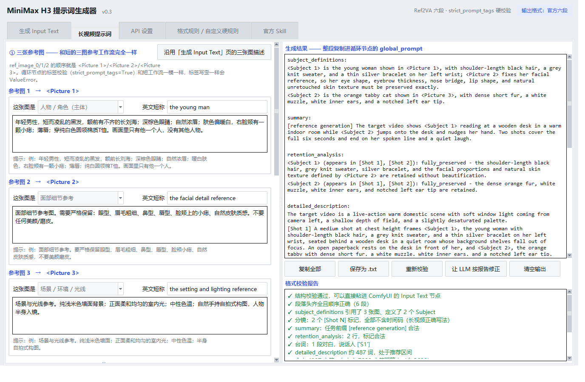

# H3 Input Text Builder v0.3 — MiniMax H3 三图参考 · Input Text 生成器

给 ComfyUI 里那条 **MiniMax H3 `Ref2VA`（3 参考图 → 视频 + 原生音频）** 工作流写 `Input Text (Prompt)` 的小工具。

对应工作流：`3图参考加速.json`

```
LoadImage ×3 (ref_image_0/1/2)  ┐
PrimitiveFloat "duration"       ├─► MiniMaxH3AudioConditioningT8
ResolutionSelector              │      task_type   = Ref2VA
PrimitiveStringMultiline ───────┘      audio_mode  = native
   "Input Text (Prompt)"               strict_prompt_tags = True   ← 标签写歪就崩
```

**为什么要这个工具**：`strict_prompt_tags = True`，媒体标签写歪、时间轴对不上、段落头拼错，渲染就废。
而你接的 LLM 没有识图能力，三张图的内容只能人工敲字 —— 这个工具把「人工敲的图片描述 + 中文需求」
用一份强约束 system prompt 编译成格式正确的英文 input text，再做一遍本地结构校验。

v0.2 起内置了 **MiniMax 官方 `h3-prompt-writing` skill 的规则**，官方 Ref2VA 六段格式成为默认输出。

**v0.3 改了什么**

- **新增「长视频提示词」页**，专门给首尾相连循环节点写提示词：禁绝对时间码、要一致性声明、
  实时分段预算、7000 字符预算进度条、逐段给词的 `segment_prompts_json` 骨架。
  详见上面「一之二」。两页共用同一套强约束规则和校验器，只是长视频模式多加了一层检查。

- **滚轮不再误改参数**。左侧长栏可以滚，但栏里的时长 / 分镜数 / 镜头预设也吃滚轮，
  往下滚页面时很容易顺手把值改错。根因是 tkinter 的绑定顺序为「控件 → 类 → toplevel → all」，
  Spinbox / Combobox 的**类绑定先跑完就把值改了**，容器上的 `bind_all` 排在最后根本拦不住。
  现在改成在控件自己身上绑并返回 `"break"` 掐断类绑定：**没焦点时滚轮一律交给长栏滚动**，
  点进去拿到焦点了才允许调值（下拉框更严，任何时候都只能点开选，不吃滚轮）。
  另外左栏里内容不满一屏的小文本框，滚轮也会穿透给长栏，不会卡在框里滚不动。
- **界面重做配色**：换到 clam 主题（vista 会忽略绝大部分颜色设置），冷灰页面 + 白卡片 + 单一强调蓝；
  分区标题上强调色，主操作按钮实心强调色，输入框聚焦时描边变强调色，滚动条改细；
  顶部加了标题栏和当前输出格式的徽标；状态栏按语义变色（报错红 / 提醒橙 / 完成绿 / 处理中蓝）。
- **自带图标**：`make_icon.py` 生成 `app.ico`（16~256 共 7 个尺寸），打包时嵌进 exe，
  窗口、任务栏、桌面快捷方式都用它，不再是 PyInstaller 的默认羽毛图标。



---

## 一、两套输出格式方案（③ 生成参数 里第一个下拉框）

### 方案 A：官方 Ref2VA 六段（默认，推荐）

来自 MiniMax 官方仓库 `MiniMax-AI/MiniMax-H3` 的 `skills/h3-prompt-writing`：

| 段落头 | 写什么 |
|---|---|
| `subject_definitions:` | 每个 `<Subject N>` 由哪些 `<Picture N>` 定义 + `Preserve exactly ...` 身份锁。**允许 N:M**：一个人物可以由「人物图 + 面部细节图」共同定义 |
| `summary:` | **必须以 `[task type]` 方括号前缀开头**，然后是 1~3 句总述 |
| `retention_analysis:` | 每个 Subject 一行：从参考里保留了什么 + 官方固定标记 |
| `detailed_description:` | 一句总述（时长/画幅/镜头基调）→ `[Shot N]` 分镜正文 → 结尾一段禁止项。**350~500 词** |
| `overall_soundscape:` | 画面内声音（环境、道具、台词口型）。**不许出现 `<d>`** |
| `non_diegetic_music:` | 画外音乐；**不要音乐就写 `N/A`** |

官方细节（工具的 system prompt 和本地校验都按这套来）：

- **task type 前缀**只有 6 个合法值：`reference generation` / `keyframe completion` /
  `video editing` / `video continuation` / `audio reuse` / `audio reference`，可以用 ` + ` 组合。
  你这条工作流是纯参考图生成，固定用 `[reference generation]`。
- **retention 标记**，画面类：`fully_preserved` / `partially_preserved` / `attribute_transfer` /
  `weak_reference`；音频类：`fully_copy` / `partially_copy` / `reference` / `weak_reference`。
  写别的词（比如 `kept_as_is`）工具会报错。
- **时间轴**：`[Shot 1]` **不带时间戳**，从第二镜起写 `[Shot 2] At 00:03.500, `，
  必须严格递增且小于总时长。官方明确禁止 `[0-1.5s]` 这种区间写法。
- **台词**：`<d>[Chinese] 你等等，我还没看完。</d>`，语言标签不能省。说话人编号紧跟主体：
  `<Subject 2> (S1) says, ...`；两人齐声用 `(S1,S2)`。
- **画外音**：必须写 `says in an off-screen voiceover`，并说明嘴唇闭合/不可见。
- **镜头**：类型 + 幅度（`with small|large amplitude`）+ 速度（`at slow|fast speed`），
  转场用 `<scenetrans>` / `<cutoff>`。
- **时长**：官方推荐 4~15 s，节点硬区间 2~15 s。

### 方案 B：工作流范例五段（旧，随时可切回）

就是你 `3图参考加速.json` 里那条范例的格式（精灵法师 × RX-78-2 高达 × 草原）：
`subject_definitions` / `detailed_description` / `overall_style` / `overall_soundscape` /
`non_diegetic_music`，时间轴用 `[0-1.5s]` 或 `[Shot 1, 0-2s]`，没音乐写 `None.`。

**为什么两套都留着**：节点源码 `h3_t8/conditioning.py` 只做
`clip.tokenize(conditioned_prompt, minimax_ref_items=...)`，**完全不解析段落** ——
所以六段和五段对节点来说都是一坨字符串，区别只在模型能不能读懂。
六段是 MiniMax 自己写的规范，默认用它；但你之前跑通的是五段，
万一六段在你手上的模型表现不好，下拉框一切就能复现旧结果。

### 会让节点当场崩掉的写法

节点 `h3_t8/prompt_tags.py::prepare_prompt` 的实测行为（工具会提前拦下来）：

| 写法 | 后果 |
|---|---|
| `<Video 1>`、`<Audio 1>` | 你这条工作流 `videos=0, audios=0`，`strict_prompt_tags=True` → **ValueError，整条工作流失败** |
| `<Picture 4>` 及以上 | 只连了 3 张图 → **同样 ValueError** |
| 裸写 `Picture 5`、`Video #3` | 节点的宽松正则**也认**，一样崩 |
| `<Image 2>` | 不崩，节点改写成 `<Picture 2>` 并给个警告 |
| `<Picture 0>` | 不崩，重映射到 1 + 警告 |
| 裸写 `Subject 1` | **不崩**（节点根本不校验 Subject），但 H3 靠 `<Subject N>` 认人，裸写等于身份锁失效 |

> 官方指南自己的 Ref2VA 示例里就带 `<Video 1>` / `<Audio 1>`（那是给「视频+音频参考」工作流看的）。
> 照抄到三图工作流上必崩 —— 这也是工具要在 system prompt 里单开一段 **FORBIDDEN TAGS** 的原因。

---

## 一之二、长视频页（首尾相连循环节点）

**第二个标签页「长视频提示词」**，专门给另一条工作流写提示词：
`MiniMaxH3LongVideoInNodeLoopT8Advanced`（In-Node Long Video Loop）。

它和短的三图参考工作流**在条件层完全同源** —— 同样的底模 / VAE / CLIP / LoRA / Sage 补丁，
同样的 `task_type=Ref2VA`、`audio_mode=native`、`strict_prompt_tags=True`、
`prompt_primary_audio_ordinal`、`ref_image_size=match`、`reference_video_policy=official_2_to_15s`
（我把循环节点的 34 个 widget 和旧 conditioning 节点的具名输入逐个对过，顺序都一致），
所以 **input text 的格式契约一个字没变**：六段结构、英文正文、`<Picture N>` / `<Subject N>`、
`<d>[语言]` 台词，全部照旧。

变的是**生成范式**，于是多出两条比格式更要命的写作铁律：

### 铁律一：删掉所有绝对时间码

循环节点把 `global_prompt` **原封不动发给每一段**，每段只渲染 124 帧（≈5.17 秒）。
旧写法里的 `[0-3s] [3-7s] [7-12s]` 会让每一段都想把这十几秒演一遍 → **情绪反复重来**。

| 禁止 | 改用 |
|---|---|
| `[0-4s] …` `[4-8s] …` | 不含时间值的 `[Shot 1]` `[Shot 2]` |
| `At 00:03.500,` | 直接接正文，不写 `At MM:SS.mmm` |
| `from 2s to 5s` | `continuously` / `gradually` / `throughout` |

需要真正做叙事（逐段不同内容）时，用节点的 `segment_prompts_json` 参数 ——
本页「分段方式」选「逐段给词」就会让模型额外给一份这个 JSON 骨架。

### 铁律二：通篇写一致性措辞

结尾必须补一句（本工具会检查概念覆盖度，不要求逐字）：

> Throughout the entire long take, keep the same subject identity, wardrobe, lighting,
> camera direction and screen direction, with a continuous and progressive emotional arc.

对应中文：整段长镜头中保持同一人物、服装、光线、镜头方向与银幕方向，情绪连续递进。

### 字数预算：官方 CLI 上限 7000 字符

`MiniMax-AI/cli` 的 `skill/h3-video/SKILL.md#core-limits` 写着 **Prompt: at most 7000 characters**
（同一节还有：输出时长整数 4–15 秒、参考图 ≤ 9 / 视频 ≤ 3 / 音频 ≤ 3、混合 ≤ 12）。

注意这是个**官方 API 提交契约，不是本地 ComfyUI 的限制** —— 节点源码
`h3_t8/prompt_budget_advanced.py` 自己写着「is not evidence of a 7000-character hard limit
in the open-weight tokenizer or local ComfyUI runtime」，而且「never truncates or silently
drops prompt content」。所以本工具把超限判成 **warn 而不是 err**，
并在页面上给实时字数进度条。要砍就砍形容词，别砍身份 / 镜头 / 连贯性事实。

### 分段预算（页面实时算，数学来自节点源码）

```
总帧 = round(总时长 × 24)
第 1 段吃满 124 帧；之后每段新增 124 − 上下文帧（context_frames ∈ {5, 22, 39}）
每段仍渲染 124 帧，其中「上下文帧」是上一段的重叠接缝 → 显存恒定，可断点续跑
```

| 总时长 | 总帧 | 段数（上下文 22） | 逐段新增帧 |
|---|---|---|---|
| 12.25 s | 294 | 3 | 124, 102, 68 |
| 30 s | 720 | 7 | 124, 102×5, 86 |
| 60 s | 1440 | 14 | 124, 102×12, 92 |

这三行是拿工作流便签里的表**逐格对过**的（`longvideo.py` 自检里就是这三条断言）。

> 改了模型 / LoRA / 提示词 / 参考图 / 分辨率 / 时长 / 采样参数，**必须换一个新的 `chain_id`**，
> 否则会被判「合同不匹配」直接报错。留意你工作流里现在还是 `ref2va_chain_v1`。

---

## 二、「官方 Skill」页

第四个标签页，用来核对官方原文：

- **从 GitHub 拉取官方指南**：下载 `SKILL.md` / `ref-en.txt` / `base-en.txt`（共约 42 KB）到
  `%APPDATA%\H3PromptBuilder\skill\`，同时记下官方仓库当时的 commit 号和时间，
  下次打开能看到「已缓存 3/3 份 · 拉取时间 · 官方最后提交」。
- **多源自动重试**：国内直连 `raw.githubusercontent.com` 是**间歇性**被 RST（`WinError 10054`，
  同一地址这次通下次断），所以工具会依次试
  `raw.githubusercontent` → `cdn.jsdelivr` → `fastly.jsdelivr` → `gcore.jsdelivr` →
  `gh-proxy.com` → `ghproxy.net` → `github.com/raw`，每个源最多试 2 次，谁先通用谁，
  三份文件共享一个总时间预算（默认 90 s）。实际走通的源会写进 `meta.json` 并显示在状态栏。
  拿回来的内容若短于 500 字符（被代理/认证门户改写的典型特征），会拒绝写缓存并报错，
  不会把垃圾留在本机。
- **文档下拉框 + 只读阅读器**：`ref-en.txt` 是 Ref2VA（你这条工作流）用的那份，
  `base-en.txt` 是分镜/运镜/说话人/台词的共用规则。
- **规则速查表**：本程序实现的六段规则、标签纪律、镜头词表、时长区间的中文摘要。

> **版权提醒**：`MiniMax-AI/MiniMax-H3` 仓库**没有 LICENSE 文件**（GitHub API 查 `/license` 返回 404，
> `spdx_id` 为空），即默认保留所有权利。所以：
> ① 原文**不打包进 exe**，只在你点按钮时下载到本机，供你自己查阅，请不要再分发；
> ② 程序发给 LLM 的提示词是 `h3_skill.py` 里**按官方规则重写的自有实现**，不含原文；
> ③ 内置的六段范例 `OFFICIAL_EXAMPLE`（女生 + 橘猫 + 书桌，6 s，2 镜）也是自己写的，不是从 `ref-en.txt` 抄的。

---

## 三、怎么用

### 直接跑（开发态）

```bat
cd S:\dsh\h3-prompt-builder
python app.py            :: 打开窗口
python app.py --selftest :: 不开窗口，跑格式校验自检
```

只用 Python 标准库（tkinter + urllib），**不需要 pip install 任何东西**。

> **macOS 用户看这里**：环境准备（tkinter 的坑）、运行、打包 .app、与 Windows 的差异，
> 见 [README-macOS.md](README-macOS.md)。

### 打包成 exe

```bat
build_exe.bat
```

产物：`dist\H3InputTextBuilder.exe`（单文件、无控制台窗口，双击即用，约 11.8 MB）。
需要本机有 `pyinstaller`（没有的话脚本会自己装）。
脚本**不会删 `dist` 目录**（里面可能有你自己放的快捷方式），只覆盖同名 exe。

图标由 `--icon app.ico --add-data "app.ico;."` 带进去：前者让 exe 文件本身有图标
（桌面快捷方式显示的就是它），后者让程序运行时能从 `sys._MEIPASS` 读到 ico 去设置
窗口 / 任务栏图标。要换图标就跑 `python make_icon.py` 重新生成再打包。

### 操作步骤

1. **API 设置** 页：填硅基流动的 API Key（base_url / model 已预填
   `https://api.siliconflow.cn/v1` + `Pro/deepseek-ai/DeepSeek-V3.2`），点「测试连接」。
   模型下拉框旁的「拉取模型列表」能直接从接口读你能用的全部模型。
2. **生成** 页：三张参考图各写一段描述（LLM 看不到图，你不写它就不知道），
   给每张图选「这张图是」什么用途（人物 / 面部细节 / 物体 / 场景光线 / 画风）+ 一个英文短称。
3. 写「视频需求」（中文即可），选 **输出格式方案**、时长、分镜数、镜头、是否循环、是否要声音段。
   选官方六段时「分镜记法」会锁死成 `[Shot N] At MM:SS.mmm`（这是官方规定，不用你选）。
4. 点 **生成 Input Text (Ctrl+Enter)** → 右侧出结果 + 校验报告。
5. 报告里有 `✗` 就点 **让 LLM 按报告修正**（把违规清单丢回去，只许改结构、不许编新内容）。
6. 点 **复制全部**，粘进 ComfyUI 的 `Input Text (Prompt)` 节点。

「载入示例」会填入「6 秒吃草莓蛋糕」那套输入，可以先拿来试跑一遍看输出长什么样。

设置和你正在写的输入（含格式方案）都会在关窗时自动存到
`%APPDATA%\H3PromptBuilder\config.json`，下次打开接着写。
旧存档没有方案字段时，工具会按你上次生成的输出里有没有 `overall_style:` 反推，不会把老内容按新格式判错。

---

## 四、工具顺带告诉你的节点参数

参数区下面那行小字是照工作流里的节点数学算的：

```
ComfyMathExpression: max(5, round(a*24)) + (5 - (max(5, round(a*24)) % 17)) % 17
```

例如 10 s → `length = 243` 帧 @24fps ≈ 10.13 s；6 s → `158` 帧 ≈ 6.58 s。
官方时长区间 `official_2_to_15s`，也就是 **2~15 秒**，超出会提示。

「主要发声主体」对应节点的 `prompt_primary_audio_ordinal`（`<Subject 1>` = 0）。

---

## 五、文件结构

| 文件 | 作用 |
|---|---|
| `app.py` | tkinter 界面（5 个标签页）、线程调度、剪贴板/保存、自检 |
| `h3_skill.py` | **官方 skill 的自有实现**：六段规则、task type / retention 词表、镜头词表、节点标签致命性判定、官方指南的拉取与本地缓存、内置六段范例、给 LLM 的官方 system prompt |
| `longvideo.py` | **长视频专用**：分段数学（窗口/上下文/段数）、绝对时间码与一致性声明的检查、7000 字符预算、给 LLM 的长视频规则块、`segment_prompts_json` 骨架 |
| `prompt_spec.py` | 格式契约分发（官方六段 / 工作流五段）、角色规则、五段范例、消息组装、修正回环 |
| `validate.py` | 输出清洗（剥围栏/开场白）+ 按方案分支的结构校验 |
| `llm_api.py` | 硅基流动 / OpenAI 兼容接口客户端，只用 `urllib` |
| `config.py` | 设置与草稿持久化 |
| `comfy_params.py` | 工作流节点数学（帧数、分辨率估算） |
| `build_exe.bat` | 一键打包 exe（带 `--icon`） |
| `make_icon.py` / `app.ico` | 生成 / 存放应用图标，7 个尺寸（16~256），打包时嵌进 exe |
| `smoke_gui.py` | GUI 冒烟测试（真建窗口、查控件和布局、切方案，不联网） |
| `test_wheel.py` | 滚轮护栏的功能测试：真的生成 `<MouseWheel>` 事件，验证没焦点时值不被改、滚轮转给长栏、有焦点时仍能正常调值、长短文本框各自的滚动归属 |
| `mock_e2e.py` | 端到端测试（本地假接口，两套方案各跑一遍 生成 → 抓错 → 修正） |
| `_shot_seed.py` / `_shot.ps1` / `_shot_restore.py` / `_shot_verify.py` | 重做 `preview.png` 用：塞示例配置 → PrintWindow 截图 → 还原真实配置 → 像素体检（含新配色是否真的生效） |
| `_shot_icon.ps1` / `_shot_icon.py` | 验证图标真的嵌进了 exe：把 exe 的图标资源导成 PNG，再用 PIL 和 `app.ico` 同帧对比强调蓝占比与平均色 |
| `_attic/` | 本地旧版本存档与研究材料（不入库） |

---

## 六、跑一遍自测

```bat
python longvideo.py      :: 长视频分段数学（对着工作流便签那张表逐格验）+ 时间码/一致性/预算
python h3_skill.py       :: 官方规则模块自检（六段范例、标签致命性 7 个用例、缓存）
python app.py --selftest :: 两套方案的 system prompt + 校验 + 清洗 + 帧数数学 + 长视频规则
python smoke_gui.py      :: 界面能不能建起来、五个标签页控件在不在、方案切换和持久化
python test_wheel.py     :: 滚轮护栏：真发 MouseWheel 事件，18 项断言
python test_longvideo.py :: 长视频全链路：拼消息 → 六段校验 → 分页回写 → 字数预算 → 分段 JSON
python mock_e2e.py       :: 起本地假接口，两套方案各走完 生成 → 抓错 → 修正 → 复制
```

`mock_e2e.py` 不回传任何真实数据，也不需要 API Key，但会把整条链路验证一遍：
官方六段那次故意返回「脏」数据（中文开场白 + 代码围栏 + `<Audio 1>` + 裸写 `Subject 1` +
切换点超时长 + summary 前缀缺失 + retention 标记非法 + `<d>` 缺语言标签），断言 6 类错全部被抓住；
五段那次返回另一套脏数据（时间轴收错 + 分段样式混用 + 正文中文）；
两次都再返回干净数据，断言 0 错误。还会打桩验证「拉取官方指南」的界面接线（不联网）。

> 两个 GUI 测试都会先把你的真实 `config.json` 挪到 `.smoke-backup` / `.e2e-backup`，
> **跑完（含中途失败）都还回去**，不会覆盖你正在写的内容。

---

## 七、防 LLM 犯错的三道闸

1. **强 system prompt**（官方方案 = `h3_skill.OFFICIAL_SYSTEM_TEMPLATE`，约 15 KB）：
   角色定位 → **「YOU ARE BLIND」条款**（禁止编造任何视觉事实，缺了就省略，不许润色）→
   **HARD MEDIA-TAG CONTRACT**（只许 `<Picture 1..3>`，`<Video N>` / `<Audio N>` 会让节点抛 ValueError）→
   输出契约 → 六个段落各自的写法 → 台词/说话人/画外音规则 → 镜头词表 →
   **发送前的 10 条自检清单** → 六段完整范例（明确标注「只准学结构，禁止抄内容」）。
   `temperature` 默认 0.4，越低越听话。
2. **本地结构校验**（`validate.check`，按方案分支）：段落头齐全且顺序正确、
   三张图都被 `subject_definitions` 引用到、没有裸写 `Subject 1`、没有超范围媒体标签、
   `[Shot N]` 编号连续且时间戳递增不超总时长、summary 前缀合法、retention 标记在官方词表内、
   `<d>` 与 `</d>` 配平且有语言标签、说话人编号 S1..Sn 连续、画外音有口型说明、
   引号外无中文、无 markdown 残留、`detailed_description` 篇幅在 350~500 词（少于 150 词直接判错）。
3. **定向修正回环**（`build_fix_messages`）：把违规清单原样丢回去，要求「保留已有内容、
   不许编新视觉事实、只修结构、不许新增 `<Video N>` / `<Audio N>`、只输出成品」。

还有「格式规则 / 自定义硬规则」页：模型反复犯同一个毛病时，你在那里追加一条硬规则
（会拼到 system prompt 最后），不用改代码。同一页能看当前方案下真正发出去的完整 system prompt。

---

## 八、已知限制 / 下一步可做

- **输出固定英文，不做中文版**（v0.2 查证后的决定，别再纠结）。依据：
  ① 官方 skill 三处明写英文 —— `SKILL.md:33`、`ref-en.txt:5`、`ref-en.txt:217`；
  ② 仓库给其他 8 个 skill 都配了 `SKILL.cn.md`、还有 `README.zh-CN.md`，**唯独 `h3-prompt-writing` 没有中文版**；
  ③ HuggingFace 讨论 [#32](https://huggingface.co/MiniMaxAI/MiniMax-H3/discussions/32)（2026-08-04，问的就是
  「支持中文提示词吗、tag 要不要换成 `<图片 1>`」）里官方人员答复：**「除了需要生成的文字和对白内容，
  其他的都要用英文描述」**；
  ④ 同帖实测反馈提到本工作流最忌的一条：中文描述的动作有时会被**当成台词念出来** ——
  而这条工作流 `audio_mode=native`，音频常开，正好踩雷。
  注：MiniMax 开放平台的 H3 示例确实是中文提示词，但那是普通 T2V/I2V 用法，不是 Ref2VA 六段重写格式。
  台词 `<d>[Chinese] 原话</d>` 和画内可见文字保持原语言，这本来就是官方规定，工具也这么要求。
- v0.2 固定 3 张图。工作流节点其实有 `ref_image_3` 空位，要四图随时能加
  （`h3_skill.CONNECTED_MEDIA` 改成 4 即可，校验和提示词都跟着走）。
- 官方指南原文要联网拉，七个源全断时拉不到；但程序照常工作 ——
  规则已经内置在 `h3_skill.py` 里，原文只是给你核对用。
- 没有预设库：同一个人物反复用时，三张图的描述要重敲（目前只靠关窗自动存草稿）。
  下一步值得做「人物预设：保存 / 载入 / 另存为 json」。
- 没有流式输出，长输出时界面只有进度条在转。
- 不校验英文语义质量，只校验结构；画面内容对不对得你自己看。
- API Key 以明文存在 `%APPDATA%\H3PromptBuilder\config.json`（可以在 API 设置页取消「记住 API Key」）。
- exe 未签名，SmartScreen 可能拦一下。
- base_url 填任何 OpenAI 兼容地址都能用（包括本地的 LM Studio / llama.cpp）。

## 许可

本项目代码 MIT，见 [LICENSE](LICENSE)。MiniMax H3 官方 skill 原文版权归 MiniMax 所有，本仓库不包含原文，运行时按需从官方仓库拉取、仅缓存在本机。
